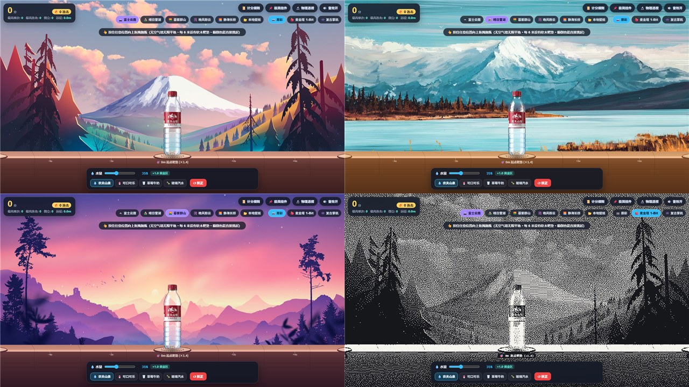

# 🧴 Desktop Bottle Flip (摸鱼立水瓶 — 真实流体桌面解压小挂件)

基于 **Google LiquidFun (`Box2D` 刚体 + `SPH` 光滑粒子流体动力学)** 打造的写实级桌面立水瓶解压小工具。
没有繁琐关卡，回归最纯粹上头的**书桌立水瓶手感**——既可在浏览器全屏游玩，也可直接运行 **`DesktopBottleFlip.exe`** 变成常驻 Windows 桌面右下角的**无边框置顶透明摸鱼小挂件**！




## ✨ 核心亮点

- **🎯 真实流体物理 + 无空气墙无限平地 (`Boundless Flatland`)**
  - 内置 Google `LiquidFun` 实时解算上百颗 `SPH` 水粒子，还原《American Journal of Physics》立水瓶流体滞后与转动惯量重分布效应；
  - **彻底移除空气墙与天花板**——无限延伸长桌（每 6 米远征软木靶垫）+ 无缝镜像视差壁纸跟拍 + 高抛平滑自动变焦；
  - 采用 **C1 圆角胶囊切线外轮廓 (`b2CircleShape` + 切线壁)** 与 **达摩摇晃稳态判定保护**——无论边缘摇晃几秒再救回正立，100% 精准触发奖励！
- **🖼️ 内置 5 款精选开源高清壁纸 + 支持上传本地壁纸**
  - 精选自 [`zhichaoh/catppuccin-wallpapers`](https://github.com/zhichaoh/catppuccin-wallpapers) 与 [`elementary/wallpapers`](https://github.com/elementary/wallpapers) 开源社区壁纸：**🗻 富士云霞**、**🏔️ 晴日雪湖**、**🌄 暮紫群山**、**🌆 晚风粉云**、**🌅 静海长桥**（前景木桌自动匹配壁纸色温），同时支持 **`📂 本地壁纸`** 一键导入电脑任意图片！
- **🎨 3 款极速丝滑视觉皮肤（满帧 144Hz 零卡顿）**
  - **📷 原彩 (`Studio`)**：高清开源风景壁纸 + 农夫山泉 / 可口可乐 / 草莓牛奶 / 玻璃汽水 4 款摄影级双层光学瓶身；
  - **🍎 麦金塔 1-Bit (`Bill Atkinson Serpentine`)**：复刻 [`Saganaki22/Dither`](https://github.com/Saganaki22/Dither) 蛇形扫描 Atkinson `1/8` 误差扩散（`< 1.1ms/帧` 极速满帧）；
  - **👾 复古掌机 (`Floyd-Steinberg DMG-01`)**：蛇形 `[7,3,5,1]/16` 误差扩散四阶橄榄绿掌机点阵（`< 0.8ms/帧`）。
- **🔊 拟真物理 Foley 合成音效（零外部音频依赖）**
  - 实时合成粉红噪声切风声、瓶内水体翻涌声（`哗啦~`）、实木桌面敲击共振、随水量动态变调的 PET 空腔弹跳声、清脆玻璃瓶泛音与连击升调马林巴和弦。
- **📜 硬核多维计分细则（越极限分越高）**
  - `单次得分 = 基础姿态分 × 空翻周数倍率 × 水量极限难度 × 瓶型系数 × 特技加成 × 连击倍率`
  - **空翻周数**：`1周 ×1.0` · `2周 ×2.6` · `3周 ×5.0` · `4周+ ×8.5`
  - **极限水量**：`35%` 黄金区 `×1.0` · `85%~95%` 满水 **`×3.0`** · **`0%` 纯空瓶宗师 `×3.5`**！
  - **桌面特技**：🙃 **瓶盖倒立基础 `350分`** · 🎯 **正中软木杯垫 `×1.4`** · ⚖️ **边缘达摩摇晃救回 `×1.5`** · ⚡ **垂直零晃动 `×1.3`**！
- **🪟 原生超轻量 Windows 桌面挂件 (`~1 MB`，告别 200MB Electron)**
  - 直接双击运行 **`DesktopBottleFlip.exe`**（或运行 `创建桌面快捷方式.bat` 发送到桌面）：
  - 顶部胶囊条支持 **`🎨` 切换皮肤**、**`🪟` 透明悬浮桌宠模式**、**`📌` 窗口置顶**，以及 **`Alt + B` 全局老板键一键秒隐/呼出**！

## 🚀 快速开始

1. **Windows 桌面挂件模式**：下载仓库后双击 `DesktopBottleFlip.exe`（或 `创建桌面快捷方式.bat`）。
2. **浏览器网页模式**：直接用任意浏览器双击打开单文件自包含的 `index.html`（零外部网络请求）。

## 🛠️ 从源码重新构建

```powershell
# 1. 重新打包单文件 index.html
python src/bundle.py

# 2. 使用 Windows 内置 .NET csc 编译器重编 DesktopBottleFlip.exe
powershell -ExecutionPolicy Bypass -File desktop-widget/build_widget.ps1
```

## 📄 License

MIT License
