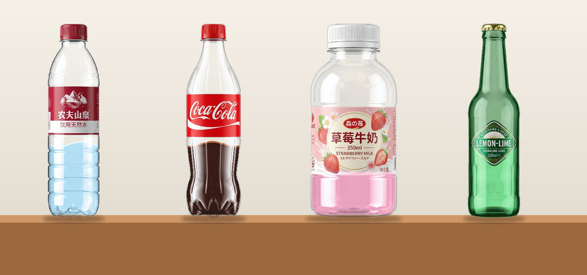

# 🧴 Desktop Bottle Flip (摸鱼立水瓶 — 真实流体桌面解压小挂件)

基于 **Google LiquidFun (`Box2D` 刚体 + `SPH` 光滑粒子流体动力学)** 打造的写实级桌面立水瓶解压小工具。
没有繁琐关卡，回归最纯粹上头的**书桌立水瓶手感**——既可在浏览器全屏游玩，也可直接运行 **`DesktopBottleFlip.exe`** 变成常驻 Windows 桌面右下角的**无边框置顶透明摸鱼小挂件**！



## ✨ 核心亮点

- **🎯 真实流体物理 + C1 平滑胶囊外碰撞壳**
  - 内置 Google `LiquidFun` 实时解算上百颗 `SPH` 水粒子，还原《American Journal of Physics》立水瓶流体滞后与转动惯量重分布效应；
  - 采用 **圆角胶囊切线外轮廓 (`b2CircleShape` + 切线壁)**，彻底消除刚体多边形接缝卡顿——斜落达摩摇晃、侧摔塑料空腔弹跳、横躺原地挑起一气呵成！
- **🎨 5 款实时后处理视觉皮肤（一键秒切）**
  - **📷 写实原木**：百叶窗暖阳书桌 + 软木靶心杯垫 + 农夫山泉 / 可口可乐 / 草莓牛奶 / 玻璃汽水 4 款摄影级双层光学瓶身；
  - **🍎 麦金塔 1984 (`1-Bit Dither`)**：经典 Apple System 1 横纹窗口 + 实时 Bayer 有序二值抖动点阵；
  - **💻 极客 ASCII (`Terminal Matrix`)**：实时荧光绿/青/粉终端字符画渲染旋转瓶身与翻涌液面；
  - **👾 复古掌机 (`GameBoy DMG`)**：1989 经典四阶橄榄绿液晶像素点阵；
  - **🌆 赛博 CRT (`Neon Scanline`)**：合成波暗色霓虹网格与隔行扫描线。
- **📜 硬核多维计分细则（越极限分越高）**
  - `单次得分 = 基础姿态分 × 空翻周数倍率 × 水量极限难度 × 瓶型系数 × 特技加成 × 连击倍率`
  - **空翻周数**：`1周 ×1.0` · `2周 ×2.6` · `3周 ×5.0` · `4周+ ×8.5`
  - **极限水量**：`35%` 黄金区 `×1.0` · `85%~95%` 满水 **`×3.0`** · **`0%` 纯空瓶宗师 `×3.5`**！
  - **桌面特技**：🙃 **瓶盖倒立基础 `350分`** · 🎯 **正中软木杯垫 `×1.4`** · ⚖️ **边缘达摩摇晃救回 `×1.5`** · ⚡ **垂直零晃动 `×1.3`**！
- **🪟 原生超轻量 Windows 桌面挂件 (`~1 MB`，告别 200MB Electron)**
  - 直接双击运行 **`DesktopBottleFlip.exe`**（或运行 `创建桌面快捷方式.bat` 发送到桌面）：
  - 顶部胶囊条支持 **`🎨` 切换皮肤**、**`🪟` 透明悬浮桌宠模式**、**`📌` 窗口置顶**，以及 **`Alt + B` 全局老板键一键秒隐/呼出**！

## 🚀 快速开始

1. **Windows 桌面挂件模式**：下载仓库后双击 `DesktopBottleFlip.exe`（或 `创建桌面快捷方式.bat`）。
2. **浏览器网页模式**：直接用任意浏览器双击打开单文件自包含的 `index.html`（零外部网络请求）。

## 🛠️ 从源码重新构建

```powershell
# 1. 重新打包单文件 index.html
python src/bundle.py

# 2. 使用 Windows 内置 .NET csc 编译器重编 DesktopBottleFlip.exe
powershell -ExecutionPolicy Bypass -File desktop-widget/build_widget.ps1
```

## 📄 License

MIT License
